  

<b>Developer × Educator</b> · सीखना और सिखाना

### 🧠 Quiz time — can you get this one?

<!-- QUIZ:START -->

<code>Go</code>&nbsp; <b>In Go, len(&quot;हिंदी&quot;) returns…</b>

<table>
<tr><td><a href="https://github.com/anuragaffection/anuragaffection/issues/new?title=quiz%3A%20Q12%20A&body=Just%20press%20**Create**%20below%20%E2%80%94%20a%20bot%20checks%20your%20answer%2C%20replies%20here%20in%20about%20a%20minute%20and%20updates%20the%20leaderboard."><b>A</b>&nbsp;&nbsp;5</a></td><td><a href="https://github.com/anuragaffection/anuragaffection/issues/new?title=quiz%3A%20Q12%20B&body=Just%20press%20**Create**%20below%20%E2%80%94%20a%20bot%20checks%20your%20answer%2C%20replies%20here%20in%20about%20a%20minute%20and%20updates%20the%20leaderboard."><b>B</b>&nbsp;&nbsp;3</a></td></tr>
<tr><td><a href="https://github.com/anuragaffection/anuragaffection/issues/new?title=quiz%3A%20Q12%20C&body=Just%20press%20**Create**%20below%20%E2%80%94%20a%20bot%20checks%20your%20answer%2C%20replies%20here%20in%20about%20a%20minute%20and%20updates%20the%20leaderboard."><b>C</b>&nbsp;&nbsp;15</a></td><td><a href="https://github.com/anuragaffection/anuragaffection/issues/new?title=quiz%3A%20Q12%20D&body=Just%20press%20**Create**%20below%20%E2%80%94%20a%20bot%20checks%20your%20answer%2C%20replies%20here%20in%20about%20a%20minute%20and%20updates%20the%20leaderboard."><b>D</b>&nbsp;&nbsp;10</a></td></tr>
</table>

Click an answer → press <b>Create</b> on the issue page → the bot replies. A new question appears when someone gets it right, and every morning. 
Be the first to solve one!
<!-- QUIZ:END -->

### 🏆 Solvers

<!-- BOARD:START -->
No one yet — your avatar could be the first here.
<!-- BOARD:END -->

 

Questions, answers and the leaderboard are run by a GitHub Action in this repo — <a href=".github/workflows/quiz.yml">see how</a>.

<i>A family of Love &amp; Affection.</i>

